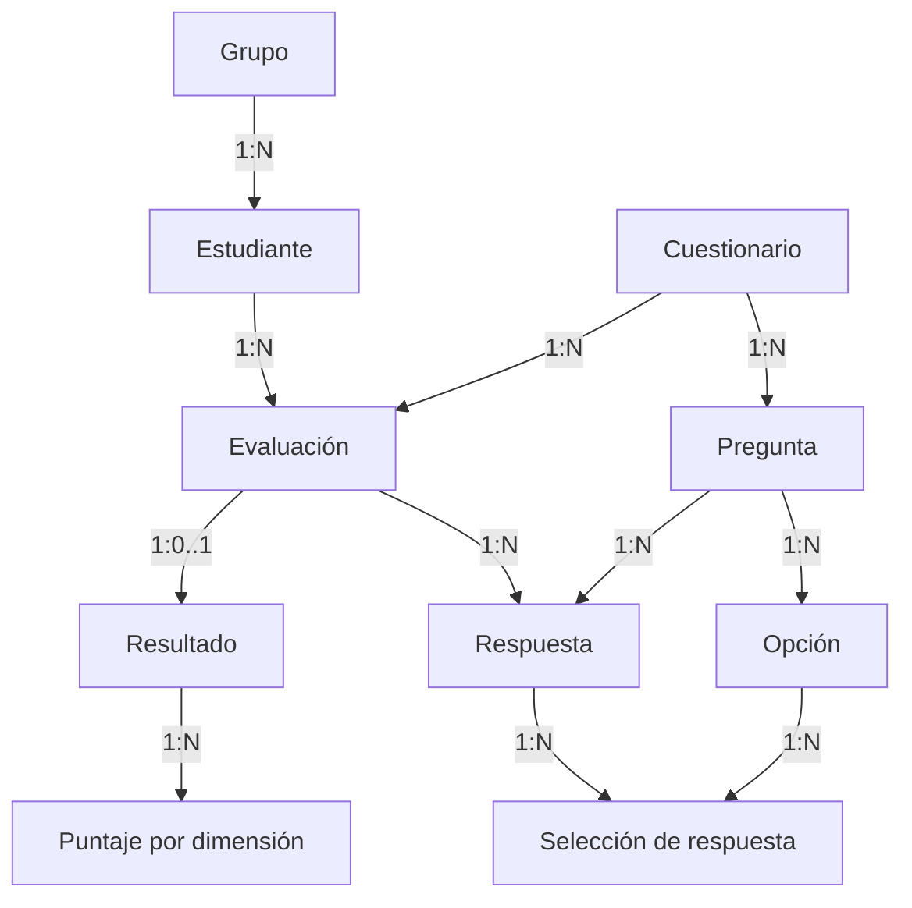

# Documentación técnica y bitácora de desarrollo
## Sistema web de aprendizaje VARK y cuestionario de personalidad

**Fecha de corte:** 22 de noviembre de 2026
**Área que documento:** Desarrollo backend e integración con base de datos
**Estado:** Modelos y migraciones integrados a `develop`; lógica de negocio y pruebas funcionales pendientes.

## 1. Propósito y alcance del trabajo

Desarrollo la parte backend de un sistema web que permite administrar grupos y estudiantes, presentar cuestionarios de preferencias de aprendizaje VARK y de personalidad, almacenar las respuestas y generar resultados consultables. El sistema forma parte de un proyecto colaborativo de tres integrantes: yo desarrollo el backend y el modelo de datos; un compañero se encarga de la interfaz; otro implementa la API REST y conecta las funcionalidades.

Mi objetivo técnico es que los datos no dependan de pantallas aisladas: deben conservarse en una base relacional, ser accesibles mediante una lógica centralizada y mantener reglas consistentes para cuestionarios, evaluaciones y puntuaciones. El proyecto contempla además autenticación administrativa, consultas, gráficas, reportes y documentación de pruebas y despliegue. La existencia de un modelo de datos no significa que todas estas funciones ya estén terminadas.

Considero VARK un instrumento de preferencias declaradas de aprendizaje y no una evaluación de conocimientos. Del mismo modo, presentaré el instrumento de personalidad como una clasificación descriptiva basada en dimensiones, no como un diagnóstico psicológico. Diferenciar estos alcances influye en cómo redactaré los resultados y sus interpretaciones.

## 2. Análisis funcional y restricciones

Identifiqué cuatro procesos centrales. Primero, el administrador organiza estudiantes y grupos. Segundo, el sistema presenta instrumentos con preguntas y opciones ordenadas. Tercero, registra cada intento, incluyendo respuestas de selección múltiple para VARK y la posibilidad de preguntas omitidas. Cuarto, calcula y conserva puntuaciones por dimensión para presentarlas individualmente y, en etapas posteriores, agregarlas por grupo.

También debo prever la administración de cuestionarios, la consulta de resultados, los reportes PDF, un panel de indicadores, un formulario de contacto, autenticación, validación de entradas y una API REST. Esas capacidades están contempladas en la estructura modular, pero algunas aún no están implementadas. No presentaré el diseño de la base como prueba de que los flujos completos funcionan.

Las restricciones prácticas son una entrega cercana, trabajo paralelo de tres integrantes y preferencia por herramientas gratuitas. Por eso prioricé una estructura reproducible, decisiones sencillas de mantener y entregas parciales revisables mediante Git.

## 3. Arquitectura que elegí

Elegí una arquitectura web en tres capas: presentación, aplicación y persistencia. La interfaz —HTML, CSS y JavaScript— solicita información y muestra formularios, preguntas y resultados. Django concentra modelos, reglas de negocio, autenticación y puntos de integración. PostgreSQL conserva los datos y aplica restricciones relacionales.

```text
[Estudiante / Administrador]
            |
            v
[Interfaz web: HTML, CSS, JavaScript]
            |
       HTTP / JSON
            |
            v
[Aplicación Django]
   | API | validaciones | servicios de puntuación |
            |
         Django ORM
            |
            v
[PostgreSQL 18: tablas, FK, restricciones]
```

Preferí esta separación frente a programar las reglas directamente en JavaScript, porque las validaciones importantes deben ejecutarse en el servidor y no depender de que el navegador las respete. También descarté que cada integrante construyera una base propia de modelos incompatibles: acordé una única estructura en Django, que servirá de contrato para los endpoints.

Elegí un monolito modular en Django, en lugar de microservicios, porque el alcance y el plazo no justifican despliegues, autenticación y comunicación distribuidos. La división en aplicaciones permite mantener responsabilidades claras sin añadir infraestructura innecesaria.

## 4. Tecnologías y razones de selección

### 4.1. Python y Django

Utilizo Python con Django 5.2.19. Django ofrece ORM, sistema de migraciones, autenticación, panel administrativo y una organización de aplicaciones que se ajusta al alcance. Frente a construir un backend desde cero, reduce trabajo repetitivo y ayuda a que los cambios de esquema queden registrados. Frente a elegir otro lenguaje o framework únicamente por preferencia personal, prioricé el entorno que ya estaba preparado y que permite trabajar al equipo con rapidez.

### 4.2. PostgreSQL y pgAdmin 4

Configuré PostgreSQL 18 como base relacional. Frente al SQLite inicial del proyecto, PostgreSQL facilita un escenario más representativo de aplicaciones multiusuario, permisos de acceso y administración mediante pgAdmin. SQLite era suficiente para iniciar el repositorio, pero no era mi elección final para la arquitectura y el diagrama entidad-relación solicitados.

Utilizo pgAdmin 4 para administrar la base, ejecutar consultas SQL y obtener el diagrama desde tablas reales. No elaboro el DER definitivo únicamente con figuras dibujadas, porque esas figuras pueden quedar desactualizadas respecto a las migraciones.

### 4.3. psycopg y python-dotenv

Instalé `psycopg` como controlador entre Python y PostgreSQL. Utilizo `python-dotenv` para cargar variables desde `.env`. Prefiero estas variables frente a escribir contraseñas dentro de `settings.py`, porque necesito compartir el proyecto sin publicar credenciales privadas.

### 4.4. Git y GitHub

Uso Git para registrar cambios con su contexto y GitHub para revisar integraciones mediante Pull Requests. La ventaja frente a sobrescribir un mismo proyecto entre integrantes es que puedo rastrear autoría, recuperar versiones y resolver conflictos antes de afectar la rama de integración.

## 5. Distribución de responsabilidades y flujo Git

Trabajo con `main` como referencia estable y `develop` como rama de integración. Los cambios se realizan en ramas `feature/...` y se fusionan mediante Pull Requests hacia `develop`. Reservo la integración a `main` para una versión conjunta comprobada.

```text
main
  └── develop
        ├── feature/backend-postgresql   [fusionada]
        ├── feature/backend-modelos      [fusionada]
        ├── feature/backend-logica       [creada; desarrollo pendiente]
        ├── feature/frontend-interfaz    [trabajo del compañero]
        └── feature/api-integracion      [trabajo del compañero]
```

Mi trabajo con PostgreSQL quedó documentado en el commit `73f978e` y se integró mediante el PR #5. Los modelos se incorporaron a `develop` mediante la fusión registrada en `47d6439`. Verifiqué localmente esa integración con `git branch --contains 5271770`, que mostró `develop` y `feature/backend-modelos`. Estos datos prueban integración de código, no sustituyen las pruebas funcionales.

Prefiero commits pequeños por módulo: los modelos de cuestionarios quedaron en `68e4fa5`, los de evaluaciones en `4694e7f` y los de resultados en `5271770`. Así puedo identificar qué cambio introdujo una entidad o restricción concreta. La configuración PostgreSQL está separada de los modelos para que la revisión no mezcle infraestructura y lógica de datos.

## 6. Estructura modular del proyecto

Dividí el proyecto Django en aplicaciones con responsabilidades específicas: `accounts` para funciones de cuentas; `students` para estudiantes y grupos; `questionnaires` para instrumentos, preguntas y opciones; `assessments` para intentos y respuestas; `scoring` para la futura lógica de cálculo; `results` para resultados persistidos; `dashboard` para indicadores; `reports` para informes; `contact` para contacto; y `api` para los puntos REST.

No significa que cada aplicación tenga toda su funcionalidad terminada. La separación prepara las responsabilidades y evita ubicar toda la lógica en un solo archivo. Consideré preferible este diseño a una sola aplicación Django porque, con tres integrantes, una estructura única habría incrementado los cambios simultáneos y las dificultades de revisión.

## 7. Configuración segura de la base de datos

Creé la base `vark_personalidad_db` en PostgreSQL 18 y el usuario de aplicación `vark_app`. El backend utiliza ese usuario en lugar de conectarse como el administrador `postgres`. Apliqué permisos específicos de utilización y creación sobre el esquema `public` porque la primera migración falló al intentar crear `django_migrations`.

Configuré la conexión Django en `config/settings.py` con las variables `DB_NAME`, `DB_USER`, `DB_PASSWORD`, `DB_HOST` y `DB_PORT`, leídas desde el entorno. Conservé `.env` fuera del control de versiones y añadí a `.env.example` únicamente valores de ejemplo. Verifiqué con `git check-ignore .env` que Git ignora el archivo privado. Ninguna contraseña real se incluye en esta documentación.

Durante la configuración resolví tres incidencias relevantes: recuperé el acceso al administrador PostgreSQL y restauré la autenticación `scram-sha-256`; corregí la contraseña del usuario `vark_app` en `.env`; y concedí permisos de creación sobre `public`. También corregí un intento de ejecutar Django con el entorno virtual inactivo. Estas incidencias me ayudaron a distinguir problemas de autenticación, de permisos y de dependencias de Python.

No traté la conexión exitosa como equivalente a tener la base lista: primero comprobé que Django pudiera conectarse y después ejecuté sus migraciones, porque autenticar no garantiza permisos de escritura.

## 8. Modelo relacional implementado

Definí diez modelos propios en cuatro aplicaciones. Los modelos son clases de Django que el ORM convierte en tablas de PostgreSQL. Los nombres de tabla siguientes siguen la convención automática de Django y corresponden a las migraciones que apliqué.

### 8.1. Estudiantes y grupos

`Grupo` contiene una clave única, nombre, estado activo y fecha de creación. `Estudiante` incluye matrícula única, nombres, apellidos, correo opcional, estado, fecha y referencia al grupo.

```text
Grupo (students_grupo)
PK id | clave UNIQUE | nombre | activo | creado_en
       1
       |
       | contiene
       N
Estudiante (students_estudiante)
PK id | matricula UNIQUE | nombres | apellidos | correo
FK grupo_id | activo | creado_en
```

Elegí una relación uno a muchos porque un grupo puede contener varios estudiantes y cada estudiante pertenece a un grupo en el alcance actual. Utilicé `on_delete=PROTECT` para que no pueda borrarse un grupo que todavía tiene estudiantes. Consideré esta restricción más segura que `CASCADE`, que eliminaría estudiantes al borrar un grupo. La separación entre ambas tablas evita repetir datos del grupo por cada alumno.

### 8.2. Cuestionarios, preguntas y opciones

`Cuestionario` identifica el título, instrucciones, descripción, tipo (`VARK` o `PERSONALIDAD`), estado y fecha. `Pregunta` contiene el texto, su cuestionario y un orden; `Opcion` contiene el texto, la dimensión asociada, el orden y la pregunta.

```text
Cuestionario 1 ───── N Pregunta 1 ───── N Opcion
                      (orden)           (dimension, orden)
```

Definí una restricción de unicidad para el par `(cuestionario, orden)` y otra para `(pregunta, orden)`. Así evito dos preguntas en la misma posición o dos opciones con el mismo orden dentro de una pregunta. Utilicé el tipo de cuestionario en una sola entidad, en lugar de crear tablas independientes para VARK y personalidad, porque ambos instrumentos comparten estructura básica, aunque tengan reglas de cálculo distintas.

La dimensión de cada opción incluye V, A, R y K para VARK, y E/I, S/N, T/F y J/P para el instrumento de personalidad. Debo validar por separado que una opción no utilice una dimensión incompatible con su cuestionario: las opciones del campo por sí solas no resuelven esa regla.

### 8.3. Evaluaciones, respuestas y selecciones

`Evaluacion` relaciona estudiante y cuestionario, identifica si el intento está en progreso o finalizado y registra sus fechas. `Respuesta` une una evaluación con una pregunta. `SeleccionRespuesta` relaciona esa respuesta con cada opción elegida.

```text
Estudiante 1 ── N Evaluacion N ── 1 Cuestionario
                        |
                        | 1:N
                        v
                     Respuesta N ── 1 Pregunta
                        |
                        | 1:N
                        v
                 SeleccionRespuesta N ── 1 Opcion
```

Elegí una tabla explícita de selecciones y no un único campo `opcion_id` en `Respuesta` porque VARK permite marcar varias opciones en una misma pregunta. Además, las preguntas pueden omitirse: en ese caso no debo inventar una opción ni sumar puntuación. Puedo representar la omisión mediante ausencia de respuesta o respuesta sin selecciones, siempre que la lógica de la API y el conteo final establezcan una convención consistente.

Definí unicidad en `(evaluacion, pregunta)` para evitar duplicar la misma pregunta dentro de un intento, y en `(respuesta, opcion)` para impedir repetir una selección. Esas restricciones no impiden por sí solas que una opción corresponda a otra pregunta; esa validación sigue pendiente. También está pendiente aplicar de forma consistente la política de una sola selección cuando el instrumento de personalidad así lo requiera.

### 8.4. Resultados y puntuaciones por dimensión

`Resultado` se relaciona uno a uno con `Evaluacion`. Registra preguntas contestadas, omitidas, interpretación y fecha de cálculo. `PuntajeDimension` vincula un resultado con una dimensión y una puntuación no negativa.

```text
Evaluacion 1 ── 0..1 Resultado 1 ── N PuntajeDimension
                            (conteos)       (dimension, puntaje)
```

Elegí `OneToOneField` porque quiero conservar un resultado vigente por intento, no varios resultados contradictorios para la misma evaluación. Una evaluación en progreso puede no tener todavía resultado. La restricción única `(resultado, dimension)` evita duplicar un mismo puntaje dimensional.

Separé almacenamiento de resultados de lógica de cálculo: `results` guarda la información calculada, mientras que `scoring` podrá calcularla a partir de las selecciones. Esto evita repetir fórmulas en las vistas y en la API, y permite probar el cálculo independientemente de cómo se presenta al usuario.

## 9. Modelo lógico integrado: relaciones principales



Este es el diagrama lógico explicativo de mis modelos, no la exportación definitiva de pgAdmin. Debo generar el DER físico desde PostgreSQL y adjuntar la evidencia en la entrega para confirmar que las claves y referencias coinciden con el esquema aplicado.

## 10. ORM y migraciones: procedimiento utilizado

Utilizo el ORM de Django para declarar clases con campos como `CharField`, `BooleanField`, `DateTimeField`, `ForeignKey`, `OneToOneField` y `PositiveIntegerField`. Prefiero esto a escribir manualmente cada instrucción `CREATE TABLE`, porque las migraciones convierten los cambios de los modelos en una secuencia versionable y repetible para mis compañeros.

Mi procedimiento de comprobación consistió en ejecutar `python manage.py check`, después `python manage.py makemigrations <app>` y, finalmente, `python manage.py migrate <app>`. Para estudiantes revisé también el SQL con `sqlmigrate`, que mostró las tablas, la clave foránea y los índices. `showmigrations` confirmó posteriormente los registros aplicados con `[X]`.

Apliqué correctamente las migraciones iniciales de `students`, `questionnaires`, `assessments` y `results`. Al terminar ejecuté `makemigrations --check --dry-run` y obtuve `No changes detected`; `migrate --check` no reportó migraciones pendientes. Estas comprobaciones prueban coherencia entre los modelos y las migraciones, pero no validan automáticamente todas las reglas de negocio ni los cálculos.

## 11. Reglas de negocio que debo implementar

### 11.1. Integridad entre cuestionario, pregunta y opción

Antes de guardar una respuesta comprobaré que la pregunta pertenece al cuestionario del intento y que todas las opciones elegidas pertenecen a esa pregunta. Si alguna selección incumple esta condición, la rechazaré sin guardar un estado parcial inconsistente. También impediré modificar evaluaciones finalizadas, salvo que exista un procedimiento administrativo explícito y auditado.

### 11.2. Diferencias entre VARK y personalidad

Para VARK permitiré cero, una o varias opciones por pregunta; una pregunta sin respuesta no aportará puntuación. Registraré correctamente cuántas preguntas quedaron contestadas y omitidas. No convertiré la ausencia de respuesta en un error automático. Para el instrumento de personalidad definiré reglas específicas de selección y de pares dimensionales, evitando asumir que ambos cuestionarios tienen idénticas condiciones.

### 11.3. Cálculo de puntuaciones

Implementaré un servicio que recorra selecciones válidas y sume puntuación por dimensión, sin fiarse de puntajes enviados desde el navegador. Guardaré el resultado de manera coherente con el estado de la evaluación. Para VARK distinguiré la suma de elecciones y el número de preguntas contestadas, porque una pregunta puede aportar más de un punto al admitir múltiples respuestas. Para personalidad tendré que definir con precisión las reglas de combinación e interpretación antes de emitir una clasificación.

### 11.4. Operaciones atómicas

Cuando una operación guarde respuestas y actualice resultados, utilizaré transacciones para evitar estados intermedios. Considero esta estrategia más segura que hacer varias escrituras sin coordinación, porque un fallo a mitad del proceso podría dejar selecciones guardadas con resultados desactualizados.

## 12. Plan de pruebas del backend

No consideraré terminada mi parte únicamente porque `check` y `migrate` funcionen. Debo crear pruebas automatizadas de modelos, servicios y validaciones. Los casos mínimos que registraré son: no permitir matrículas duplicadas; proteger un grupo con estudiantes; impedir orden repetido de preguntas u opciones; permitir selecciones múltiples en VARK; aceptar omisiones VARK; rechazar una opción ajena a la pregunta; impedir selecciones duplicadas; impedir respuestas en intentos finalizados; verificar conteos de preguntas omitidas; calcular de forma reproducible cada dimensión; y garantizar un resultado por evaluación.

Documentaré para cada prueba el dato inicial, la acción, el resultado esperado, el resultado obtenido y la evidencia de ejecución. Las pruebas pendientes no se reportarán como aprobadas hasta ejecutarlas.

## 13. Integración de mi trabajo con la API

Con los modelos integrados en `develop`, mi compañero de API puede actualizar su rama y utilizar las clases reales. La API debe exponer recursos de cuestionarios, evaluaciones, respuestas y resultados, pero sus rutas definitivas, permisos y contratos JSON deben acordarse entre ambos. Los ejemplos de rutas conversados previamente son propuestas de diseño; no constituyen endpoints implementados.

Evito que el compañero duplique los modelos o cree migraciones incompatibles. Prefiero que la API invoque servicios de validación y puntuación compartidos, en lugar de implementar fórmulas por su cuenta. Esto reduce el riesgo de obtener resultados diferentes entre endpoints y reportes.

## 14. Seguridad y mantenimiento

Mi configuración separa credenciales y código fuente; utiliza un usuario limitado de base de datos y conserva los archivos locales fuera de Git. Aún debo revisar autenticación, autorización por tipo de usuario, protección de datos personales, validación de formularios, errores de API y seguridad de despliegue. No asumiré que una contraseña protegida por `.env` soluciona por sí sola la seguridad de toda la aplicación.

Evitaré almacenar información personal innecesaria. La matrícula y el correo son datos que requieren tratamiento cuidadoso; el acceso a resultados individuales deberá restringirse según el rol y el propósito del sistema.

## 15. Registro cronológico y evidencias comprobadas

**Preparación del entorno.** Inicialicé el proyecto Django, definí módulos, preparé el entorno virtual y configuré variables de entorno. Corregí el problema de Django no encontrado al reactivar `.venv`.

**PostgreSQL.** Creé `vark_personalidad_db`, configuré `vark_app`, ajusté permisos y verifiqué la conexión con `connection.ensure_connection()`. El resultado mostró `Motor: postgresql` y la base esperada. Apliqué las migraciones internas de Django y registré la configuración en `73f978e`.

**Modelos de estudiantes.** Definí Grupo y Estudiante; generé y apliqué `students.0001_initial`; revisé que el SQL incluyera la relación por `grupo_id`.

**Modelos de cuestionarios.** Definí Cuestionario, Pregunta y Opcion, con restricciones de orden; generé y apliqué `questionnaires.0001_initial`. Registré el cambio con `68e4fa5`.

**Modelos de evaluaciones.** Definí Evaluacion, Respuesta y SeleccionRespuesta; generé y apliqué `assessments.0001_initial`. Registré el cambio con `4694e7f`.

**Modelos de resultados.** Definí Resultado y PuntajeDimension; generé y apliqué `results.0001_initial`. Registré el cambio con `5271770`.

**Integración.** Subí `feature/backend-modelos`, fusioné el Pull Request y actualicé `develop` a `47d6439`. Comprobé que `develop` contiene `5271770` y que el árbol de trabajo quedó limpio. La rama `feature/backend-logica` ya fue creada para continuar; aún no atribuyo a ella código funcional que no haya escrito o probado.

## 16. Pendientes y criterio para dar por terminada mi parte

Quedan pendientes el servicio de validación de respuestas, el cálculo y la interpretación de las dimensiones, las pruebas automatizadas, el diagrama físico exportado desde pgAdmin y la verificación de los endpoints con el compañero de integración. También falta preparar evidencias de instalación y ejecución, contribuir al diagrama de Gantt y revisar la documentación de despliegue.

Daré por completado mi backend cuando pueda crear y consultar registros reales, rechazar entradas inválidas, registrar omisiones y selecciones múltiples correctamente, producir resultados reproducibles desde las respuestas guardadas y demostrarlo con pruebas automatizadas. El hecho de haber completado las tablas es un avance sólido, pero no es todavía el cierre funcional.

## 17. Decisiones técnicas resumidas y alternativas descartadas

| Decisión que tomé | Alternativa considerada | Razón de mi elección |
|---|---|---|
| Monolito modular Django | Microservicios | Menos infraestructura y complejidad para el plazo y tamaño del equipo |
| PostgreSQL 18 | Mantener SQLite | Mejor administración de permisos, trabajo relacional y DER desde pgAdmin |
| Django ORM y migraciones | SQL de creación escrito a mano | Esquema versionado y reproducible con el código |
| `vark_app` | Conectarme como `postgres` | Menor exposición de privilegios administrativos |
| `.env` y `.env.example` | Contraseñas en `settings.py` | Evitar publicar secretos y facilitar la configuración por equipo |
| Tablas separadas de grupos y estudiantes | Repetir grupo en cada registro | Evitar redundancia y mantener integridad referencial |
| Selecciones como entidad propia | Una sola opción en Respuesta | Permitir múltiples elecciones VARK y controlar duplicados |
| Resultado separado de Evaluacion | Guardar puntajes en cada respuesta | Separar datos de origen, cálculo e interpretación |
| Ramas y Pull Requests | Trabajar directamente en `main` | Revisar cambios y reducir conflictos entre integrantes |
| DER desde la base real | Solo un dibujo manual | Mantener congruencia entre documentación y tablas migradas |

## 18. Cierre de este corte documental

En este punto construí y migré diez modelos propios distribuidos en cuatro aplicaciones, comprobé su consistencia estructural con Django y los integré en `develop` para facilitar el trabajo del equipo. Puedo explicar qué entidad representa cada tabla, qué relación necesita, qué restricciones aplica y por qué elegí este diseño frente a soluciones más simples pero menos adecuadas.

Mi siguiente actividad es implementar reglas de negocio y servicios de puntuación en la rama `feature/backend-logica`. No consideraré finalizada la aplicación hasta comprobar que sus resultados provienen de respuestas válidas y que el frontend y la API utilizan las mismas reglas.
